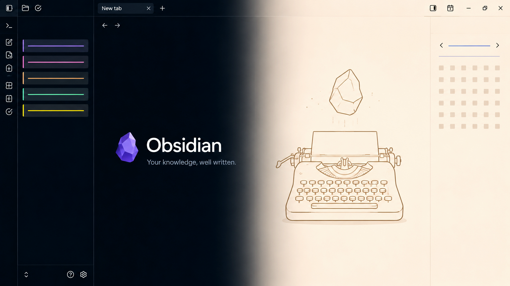

# Unsent Letters — Frozen Typewriter

An icy, low-glare theme for [Obsidian](https://obsidian.md), designed for long writing sessions. It pairs a soft-contrast palette with typewriter-style headings, focus tools, four color presets (each with a dark and a light variant) and a fully configurable interface.

## Overview

Unsent Letters is built for sustained drafting rather than first impressions. The defaults favor readability after hours of use: a measured line length, generous but not loose line height, body text contrast well above WCAG AAA but short of glare, and writing aids that keep attention on the current line.

## Features

### Writing experience

- **Focus mode:** inactive lines dim while the active line stays at full opacity. A slight blur is available but off by default, since blurred text makes the eye refocus.
- **Breathing cursor:** a smooth opacity fade replaces the hard on/off blink.
- **Typewriter scrolling:** extra vertical padding lets the active line stay centered in the pane, like a typewriter carriage. Works with Obsidian's typewriter scroll setting.
- **Paper grain:** a barely visible noise layer over the editor surface.
- **Zen mode:** hides the tab bar, ribbon and status bar completely.
- **Readable layout:** about 70 characters per line by default (680px at 17px), with configurable content width, line height and letter spacing.

### Drafting tools

- **Dialogue highlighting:** text wrapped in `<q>` elements receives a configurable warm tint.
- **Draft comments:** Obsidian `%% comment %%` syntax gets its own color and background, separating notes-to-self from the manuscript.

### Icons

A typewriter and a snowflake, drawn for this theme as 24px line icons.

- **Callouts:** `> [!typewriter]` (aliases `draft`, `manuscript`) and `> [!snowflake]` (aliases `frost`, `winter`).
- **Horizontal rules:** `---` renders as a scene break with a snowflake in the center.
- **Note titles:** a small typewriter before the inline title. Switch it to the snowflake or turn it off.
- **Word count:** a typewriter in the status bar pill.

### Interface

- Styled callouts (all built-in types), tags, tables, code blocks, blockquotes, task checkboxes, buttons, modals and the quick switcher.
- A single-accent file explorer with consistent hover and active states.
- Alternative styles for callouts (tinted box, left bar, outline) and links (border underline, text underline, none).

## Color presets

Choose a preset in **Style Settings → Color presets**. Every preset has a dark and a light variant and follows Obsidian's Appearance setting.

| Preset                          | Dark                                              | Light                                                                  |
| ------------------------------- | ------------------------------------------------- | ---------------------------------------------------------------------- |
| **Frozen Typewriter** (default) | Arctic blue-black surfaces with ice-blue accents. | Warm cream surfaces with pink, gold and wine accents ("Killer Queen"). |
| **Strawberry**                  | Soft pink on a warm berry-charcoal base.          | Pink-tinted paper with a strawberry accent.                            |
| **Purple-haze**                 | Vivid violet on deep purple surfaces.             | Lavender paper with an intense purple accent.                          |
| **Blackout**                    | Near-black and silver greys, muted status colors. | Light grey paper with graphite ink.                                    |

A preset replaces the whole palette and takes priority over colors saved in Style Settings. To adjust colors by hand, use the Frozen Typewriter preset: the color pickers apply to it only, and they always show its defaults.

## Customization

All options are exposed through the [Style Settings](https://github.com/mgmeyers/obsidian-style-settings) plugin, with no CSS editing required. Settings are grouped into collapsible sections:

| Section              | Includes                                                                                                                                                                       |
| -------------------- | ------------------------------------------------------------------------------------------------------------------------------------------------------------------------------ |
| **Color presets**    | Frozen Typewriter, Strawberry, Purple-haze and Blackout, each in dark and light.                                                                                               |
| **Colors**           | Surfaces, accent, frost tint, text, links, borders, status colors, headings, code syntax, shadows. Set separately for light and dark. Applies to the Frozen Typewriter preset. |
| **Typography**       | Prose, monospace, UI and heading fonts; size, weight, line height, letter spacing, alignment, hyphenation.                                                                     |
| **Headings**         | Size, weight and letter spacing per level; text transform; H1 underline.                                                                                                       |
| **Layout & motion**  | Content width, padding, border radii, scrollbar width, transition speed and easing.                                                                                            |
| **Writing aids**     | Focus dim and blur, cursor, typewriter padding, paper grain, dialogue and comment colors.                                                                                      |
| **Content elements** | Links, blockquotes, code, callouts, tags, tables and tasks.                                                                                                                    |
| **Interface**        | Tabs, file explorer, status bar, buttons and modals.                                                                                                                           |
| **Icons**            | Note title icon (typewriter, snowflake or none); toggles for the snowflake rule and the word count icon.                                                                       |
| **Features**         | Toggles for focus dimming, breathing cursor, paper grain, pane frame, hover effects, status bar and ribbon.                                                                    |

## Defaults

| Setting        | Value                   |
| -------------- | ----------------------- |
| Font size      | 17px (16px below 768px) |
| Line height    | 1.7                     |
| Letter spacing | 0.01em                  |
| Content width  | 680px                   |
| Focus blur     | 0px                     |
| Paper grain    | 0.015 opacity           |
| Easing         | `ease-out`              |

## Installation

Style Settings is optional but required to change the defaults and to switch presets.

1. Open your vault folder and go to `.obsidian/themes/`.
2. Create a folder named `Unsent Letters`.
3. Copy `theme.css` and `manifest.json` into it.
4. In Obsidian, open **Settings → Appearance → Themes** and select **Unsent Letters**.
5. Optionally install **Style Settings** from Community plugins to customize the theme.

## Accessibility and performance

- **Contrast:** body text sits at roughly 10.5–12.5:1 in every preset (WCAG AAA asks for 7:1). Muted text is at least 6:1, faint text at least 4.2:1, and headings, links and callout colors at least 4.8:1.
- **No pure black or white:** dark surfaces are deep but not void, and light surfaces are tinted paper, to limit glare and halation.
- **Selection:** selected text keeps the normal text color for readable contrast.
- Respects `prefers-reduced-motion`: transitions and the breathing cursor are disabled.
- Responsive layout: smaller base font size and full-width content below 768px.
- No `@import`, no network requests and no bundled fonts. Headings prefer Courier Prime and code prefers IBM Plex Mono, with Courier New and system monospace as fallbacks. Any font named in the settings must be installed locally.

## License

MIT. See [LICENSE](LICENSE).
